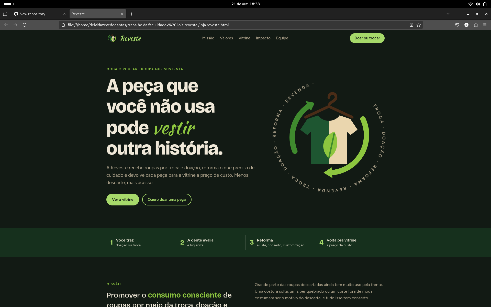

# 👕 Reveste

Site desenvolvido como trabalho em grupo do curso de **Análise e Desenvolvimento de Sistemas** no **Centro Universitário FMU**.

A Reveste é um projeto de **moda circular**: recebe roupas por troca e doação, reforma o que precisa de cuidado e devolve cada peça para a vitrine a preço de custo. Menos descarte, mais acesso.

---

## 📸 Preview

   

---

## 🚀 Tecnologias utilizadas

- HTML5
- CSS3 (variáveis, Grid, Flexbox, tema claro/escuro automático)
- JavaScript (vitrine com filtros, calculadora de impacto e formulário)
- SVG (logo e ilustrações)
- Google Fonts

---

## 📂 Estrutura do projeto

```
loja-reveste/
├── index.html        # Site completo (HTML, CSS e JavaScript)
├── assets/
│   └── preview.png   # Print do site
└── README.md
```

---

## ⚙️ Como rodar o projeto

1. Clone o repositório:
   ```bash
   git clone https://github.com/deividazevedo292-coder
   ```
2. Entre na pasta:
   ```bash
   cd loja-reveste
   ```
3. Abra o arquivo `index.html` no navegador
   (ou use a extensão **Live Server** do VS Code).

---

## 👥 Equipe

| Integrante | Responsabilidade |
|---|---|
| **Deivid Azevedo Dantas** | Estrutura do site (HTML e organização das páginas) |
| Nicollas Gomes Valesini | Integrante do grupo |
| Wilian Santana | Integrante do grupo |
| Rafael Moreira Santos Costa | Integrante do grupo |
| Vitor Gustavo | Integrante do grupo |
| Eduardo Freire | Integrante do grupo |

---

## 🧠 O que aprendi

Neste projeto fiquei responsável pela estrutura do site, o que me ajudou a praticar HTML semântico, organização de arquivos e trabalho em equipe.

---

## 📄 Licença

Projeto acadêmico, sem fins comerciais.

---

Feito por **Deivid Azevedo Dantas**
